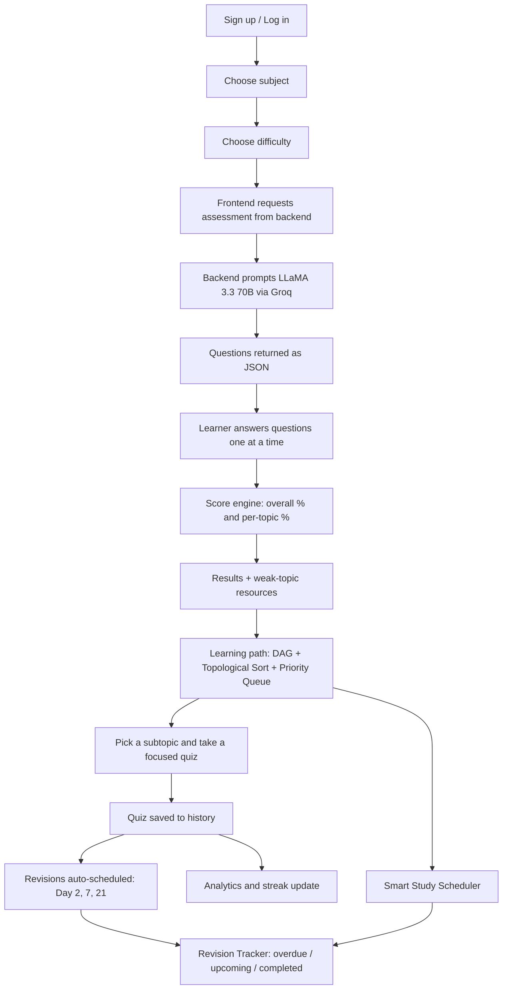

# 🎓 Personalized Learning Path Generator

**An adaptive, AI-assisted study platform that finds what you don't know, builds a prerequisite-aware learning path, schedules your study time, and brings topics back for revision right before you forget them.**

Built as a Design & Analysis of Algorithms (DAA) capstone: every core feature is backed by a classic algorithm, and every algorithm has a concrete job in the product.

[](https://learning-path-frontend-3voe.onrender.com/)


| | Link |
|---|---|
| 🌐 **Live app** | https://learning-path-frontend-3voe.onrender.com/ |
| ⚙️ **Backend API** | https://learning-path-backend-5v2v.onrender.com |
| 💻 **Source code** | https://github.com/Monish0306/learning-path-generator1 |

> **Note:** The backend runs on a free hosting tier, so the first request after a period of inactivity can take a short while to wake up. Subsequent requests are fast.

---

## 📑 Table of Contents

1. [The Problem](#-the-problem)
2. [What Makes This Different](#-what-makes-this-different)
3. [Key Features](#-key-features)
4. [How It Works: End-to-End Flow](#-how-it-works-end-to-end-flow)
5. [Algorithms and Where They Are Used](#-algorithms-and-where-they-are-used)
6. [Scoring and Mastery Logic](#-scoring-and-mastery-logic)
7. [Smart Study Scheduler](#-smart-study-scheduler)
8. [Forgetting Curve and Revision Tracker](#-forgetting-curve-and-revision-tracker)
9. [Analytics and Dashboard](#-analytics-and-dashboard)
10. [Learning Resources for Weak Topics](#-learning-resources-for-weak-topics)
11. [System Architecture](#-system-architecture)
12. [API Reference](#-api-reference)
13. [Data Model](#-data-model)
14. [Project Structure](#-project-structure)
15. [Tech Stack](#-tech-stack)
16. [Run Locally](#-run-locally)
17. [Deployment](#-deployment)
18. [Engineering Challenges and Fixes](#-engineering-challenges-and-fixes)
19. [Limitations and Future Work](#-limitations-and-future-work)
20. [Author](#-author)

---

## 🎯 The Problem

Most study tools treat every learner the same:

- Everyone follows the same syllabus order, at the same pace.
- Time is spent re-reading topics already mastered, while weak topics stay weak.
- A quiz ends with a number ("6/10") and no guidance on what to do next.
- Material is learned once and then forgotten, because nothing brings it back at the right time.
- Topics are studied in the wrong order (for example, classes before functions), which makes learning harder than it needs to be.

## ✨ What Makes This Different

| Traditional / typical quiz apps | This project |
|---|---|
| Fixed question banks that learners memorise | Questions generated on demand by an LLM, matched to subject, topic and difficulty |
| One overall score | **Overall score plus an individual score for every topic**, colour-coded |
| Score screen is a dead end | **Every weak topic comes with curated learning resources** (direct video and article links) |
| Same syllabus order for everyone | **Learning path built from a prerequisite graph**, weakest topics first, mastered topics skipped |
| "Study when you feel like it" | **Auto-generated study schedule** from your weak topics, daily hours, session length and exam date |
| No memory model | **Spaced-repetition revisions at Day 2, 7 and 21** scheduled automatically after each quiz |
| Progress is a single bar | Dashboard, per-subject analytics, weak-area ranking and a **learning streak** |
| Accounts, tracking, databases | **Runs without a user database**: profile and history stay in the browser |

---

## 🚀 Key Features

### 1. Adaptive Assessment
Pick one of **8 subjects** (Python, DAA, Machine Learning, AI, DBMS, Java, C, C++) and one of **3 difficulty levels** (Basic, Medium, Advanced). The backend asks an LLM (LLaMA 3.3 70B via Groq) for fresh multiple-choice questions, so assessments are not repetitive.

### 2. Topic-wise Scoring
Results show the **overall percentage** and a **separate percentage for each topic**, colour-coded so weak spots are obvious at a glance.

### 3. Personalised Learning Path
Topics are modelled as a prerequisite graph. The path lists weak topics in priority order (weakest first), respects prerequisites, and marks strong topics as already mastered so you can skip them.

### 4. Subtopic Quizzes
Each topic breaks into subtopics. Pick a subtopic, choose a difficulty, and take a focused quiz with a full answer review (correct and incorrect answers with explanations).

### 5. Learning Resources on Every Weak Topic
Quiz and dashboard views do not just show a score. They give **direct links to videos and articles** for the topics you scored poorly on, so the next step is one click away. See [Learning Resources](#-learning-resources-for-weak-topics).

### 6. Smart Study Scheduler
Set daily study hours, preferred time of day, days per week, session length and an optional exam date. The scheduler produces a day-by-day plan ordered by topic priority. See [Smart Study Scheduler](#-smart-study-scheduler).

### 7. Revision Tracker (Forgetting Curve)
Every completed quiz automatically schedules revisions at **Day 2, Day 7 and Day 21**. The tracker groups them into **Overdue**, **Upcoming (next 7 days)** and **Completed**. See [Forgetting Curve](#-forgetting-curve-and-revision-tracker).

### 8. Analytics
Learning streak, overall performance, subject-wise performance bars and quiz history.

### 9. Profile Dashboard
Assessments taken, quizzes attempted, subjects studied, average score, recent activity, subject progress cards with a *Continue Learning* shortcut, and the top weak areas with study resources.

### 10. My Learning and Settings
**My Learning** lists every active subject with progress and focus areas. **Settings** lets the learner tune the mastery threshold, study goal and reminder preferences.

---

## 🔄 How It Works: End-to-End Flow



### Step by step

1. **Sign up / log in.** The profile is created and stored in the browser's LocalStorage.
2. **Select a subject and difficulty.** Choices are kept in a global session state.
3. **Assessment request.** The frontend calls the backend, which builds a prompt for the LLM and returns structured JSON questions.
4. **Quiz.** Questions are shown one at a time with a progress bar, and answers are held in memory until submission.
5. **Scoring.** The score engine computes the overall percentage and a percentage per topic.
6. **Results.** The learner sees the score ring, a colour-coded topic breakdown and study resources for weak topics.
7. **Learning path.** Topics are ordered with a DAG and topological sort, then ranked by weakness with a priority queue.
8. **Subtopic quizzes.** Each quiz is saved to history with its date and score.
9. **Revisions.** Day 2, 7 and 21 revision dates are derived from the quiz date.
10. **Scheduler, tracker and analytics.** All read from the same stored profile, so everything stays consistent.

---

## 🧮 Algorithms and Where They Are Used

| # | Algorithm / Technique | Where it is used in the product | Why this one | Complexity |
|---|---|---|---|---|
| 1 | **Directed Acyclic Graph (DAG)** | Models topic prerequisites (for example Variables → Control Flow → Functions → Classes) | Prerequisites are directed and must never be circular | Build: O(E) |
| 2 | **Topological Sort (Kahn's algorithm)** | Produces a valid study order so no topic appears before its prerequisites | Guarantees prerequisite-respecting order | O(V + E) |
| 3 | **Priority Queue (Min-Heap)** | Ranks weak topics so the weakest is dequeued first; also feeds the scheduler | Efficient "give me the most urgent item" operation | O(log n) per operation |
| 4 | **A\* search** | Estimates the cheapest route from the learner's current knowledge to mastery using f(n) = g(n) + h(n) | Heuristic-guided search minimises total study cost | O(E log V) |
| 5 | **Greedy selection** | Quick-win ordering by potential improvement (100 − score); session-by-session slot filling in the scheduler | Locally best choice is cheap and effective for planning | O(n log n) |
| 6 | **Dynamic Programming (0/1 Knapsack)** | Chooses which topics to study within a fixed time budget to maximise total score improvement | Classic optimal-substructure problem | O(n × t) |
| 7 | **Spaced repetition (Ebbinghaus forgetting curve)** | Schedules revisions at Day 2, 7 and 21 after each quiz | Reviewing just before forgetting strengthens long-term memory | O(q) over quiz history |
| 8 | **Percentage scoring** | Overall, per-topic and per-subject scores | Simple, transparent, explainable | O(n) per quiz |
| 9 | **Streak calculation** | Counts consecutive study days backwards from today | Motivation and consistency tracking | O(d log d) over unique dates |

### Priority formula

```
priority = (100 − score) / 10          weaker topic    → higher priority
         + min(daysSinceStudy / 7, 5)  longer gap      → higher priority (capped)
         + typeWeight                  weak = 3, revision = 2, new = 1
```

**Example:** a topic at 30% scores 7 + 3 = **10**; a revision topic at 70% that was last studied 14 days ago scores 3 + 2 + 2 = **7**; a new topic at 85% scores 1.5 + 1 = **2.5**. Study order: 10 → 7 → 2.5.

---

## 📊 Scoring and Mastery Logic

**Overall assessment score**

```
score = (correct answers ÷ total questions) × 100
```

**Topic-wise score.** Questions are grouped by their topic tag and the same percentage is computed per group. Example: Variables 2/3 → 67%, Loops 3/4 → 75%.

**Averages.** Overall average is the mean of all quiz scores in history. Subject average is the mean of quiz scores for that subject.

**Colour bands**

| Score | Band | Meaning |
|---|---|---|
| 75–100% | 🟢 Green | Strong understanding |
| 50–74% | 🟡 Yellow | Moderate, needs practice |
| 0–49% | 🔴 Red | Weak, needs focus |

**Thresholds used by features**

| Threshold | Used for |
|---|---|
| **70%** (default, adjustable in Settings) | Mastery: topics below this appear in the learning path and the scheduler |
| **< 60%** | Dashboard "Weak Areas" ranking (top 5, with study resources) |

---

## 📅 Smart Study Scheduler

**Algorithm:** greedy slot allocation over a priority queue.

**Inputs:** daily study hours, preferred time of day, days per week, session duration, optional exam date.

**Process**

1. **Collect topics that need attention:** topics below the mastery threshold, plus topics currently due for revision.
2. **Prioritise** them with the priority formula above (weak topics outrank revisions, which outrank new topics).
3. **Estimate time needed** from current mastery:

   | Current mastery | Time estimate |
   |---|---|
   | Below 30% | 90 min |
   | 30–50% | 60 min |
   | 50–70% | 45 min |
   | Above 70% (revision) | 30 min |

4. **Allocate sessions greedily:** sessions per day = (daily hours × 60) ÷ session length. Take the highest-priority topic, fill the next free slot, and carry any remaining time into the next session or day.
5. **Output** a day-by-day schedule with time slots, topic, priority and reason, a summary (days, sessions, hours) and the upcoming revisions.

---

## 🧠 Forgetting Curve and Revision Tracker

**Why:** without review, most new material fades quickly (Ebbinghaus forgetting curve). Reviewing at growing intervals moves it into long-term memory.

**Intervals used:** **Day 2 → Day 7 → Day 21** after each quiz.

**How it works**

1. A completed quiz is stored with subject, topic, subtopic, score and date.
2. For each quiz, three target dates are derived: date + 2, + 7 and + 21 days.
3. The tracker compares each target date with today and sorts revisions into:
   - 🔴 **Overdue:** target date has passed (shown with how many days late)
   - 🟡 **Upcoming:** due within the next 7 days
   - 🟢 **Completed:** recently completed quizzes
4. Revisions are labelled **R1, R2, R3**, and revision topics also feed into the scheduler.

---

## 📈 Analytics and Dashboard

- **Learning streak:** unique quiz dates are sorted newest first, then counted day by day backwards from today until a day is missing.
- **Overall performance:** total quizzes, average score, subjects studied.
- **Subject-wise performance:** progress bar and average per subject.
- **Assessment and quiz history:** recent attempts with dates and scores.
- **Weak areas:** the five lowest-scoring topics with a *Study Resources* dropdown and a *Practice* button.
- **Priority recommendation:** a highlighted suggestion for the single most important topic to work on next.

---

## 📚 Learning Resources for Weak Topics

Scores alone do not help someone improve, so the app attaches **curated resources to the topics a learner struggles with**:

- **Direct video links:** each link points straight to a specific video for that subtopic, not to a search results page.
- **Article links:** reference articles for the same subtopic.
- **Smart matching:** the resolver tries an exact subtopic match, then case-insensitive, then partial match, then topic-level fallback, so a link is almost always available.
- **Coverage:** all 8 subjects, mapped at subtopic level (for example Python: Lambda Functions, Exception Handling; DAA: Asymptotic Notations, Graph Traversal, DP Fundamentals; C: Pointers, Arrays, Loops).
- **Where they appear:** under weak topics in the dashboard, and alongside quiz and assessment results.

---

## 🏗️ System Architecture

```
┌──────────────────────────┐        HTTPS / JSON        ┌───────────────────────────┐
│        FRONTEND          │ ─────────────────────────▶ │          BACKEND          │
│  HTML + CSS + JS (SPA)   │                            │     Node.js + Express     │
│  Render static site      │ ◀───────────────────────── │  Render web service (SG)  │
│                          │                            │                           │
│  • UI screens & routing  │                            │  • Subject & quiz routes  │
│  • Algorithms (DAG, PQ,  │                            │  • Prompt building        │
│    A*, DP, scheduler)    │                            │  • Question bank (JSON)   │
│  • Score engine          │                            └─────────────┬─────────────┘
│  • LocalStorage profile  │                                          │ API call
└──────────────────────────┘                                          ▼
                                                      ┌───────────────────────────┐
                                                      │   Groq API                │
                                                      │   LLaMA 3.3 70B Versatile │
                                                      └───────────────────────────┘
```

**Design decisions**

- **Heavy logic in the browser.** Graph algorithms, scoring, scheduling and revision logic run client-side, so the backend stays thin and cheap to host.
- **Backend does what a browser can't:** keeps the API key secret, talks to the LLM and serves questions.
- **No user database.** Profiles, assessments, quiz history and preferences live in LocalStorage, which keeps hosting free and keeps learner data on their own device.
- **Frontend ↔ backend link.** The frontend picks its API base URL from `window.location.hostname` (localhost in development, the deployed backend in production), and the backend enables CORS for the frontend origin.

---

## 🔌 API Reference

Base URL (production): `https://learning-path-backend-5v2v.onrender.com`

| Method | Endpoint | Purpose |
|---|---|---|
| `GET` | `/health` | Service health check |
| `GET` | `/api/subjects` | List available subjects |
| `POST` | `/api/assessment/start` | Start an assessment for a subject and difficulty and return questions |
| `POST` | `/api/assessment/submit` | Submit assessment answers for scoring |
| `GET` | `/api/learning-path/:id` | Fetch learning-path data |
| `POST` | `/api/quiz/subtopic` | Generate a focused quiz for a subtopic |
| `POST` | `/api/quiz/submit` | Submit subtopic quiz answers |

> Exact request and response fields are defined in `backend/server.js`. Check that file before building clients against the API.

---

## 🗂️ Data Model

Stored in the browser under a per-user key.

```
UserProfile
├── userId, name, email, university, createdAt
├── assessments[]   { subject, score, topicScores{topic → %}, date }
├── quizHistory[]   { subject, topic, subtopic, score, questionsCount, date }
└── preferences     { masteryThreshold, studyGoal, dailyStudyHours,
                      preferredTimeSlot, revisionReminders, dailyReminders }
```

Question objects returned by the backend:

```
{ id, topic, question, options[4], correctAnswer, explanation }
```

---

## 📁 Project Structure

```
learning-path-generator1/
├── backend/
│   ├── data/questions/          # Per-subject question banks (JSON)
│   │   ├── python.json  daa.json  ml.json  ai.json
│   │   └── dbms.json    java.json c.json   cpp.json
│   ├── services/
│   │   ├── groq.js              # LLM integration (active)
│   │   └── gemini.js            # Earlier integration (legacy)
│   ├── server.js                # Express server and routes
│   ├── test-groq.js             # Quick API-key / model check
│   └── package.json
│
└── frontend/
    ├── index.html               # Single-page app shell and all screens
    ├── css/
    │   ├── styles.css
    │   └── enhancements.css
    └── js/
        ├── profile.js           # UserProfile model + LocalStorage helpers
        ├── auth.js              # Sign-up / login
        ├── algorithms.js        # DAG, topological sort, priority queue, A*, DP
        ├── reference-links.js   # Resource mapping for every subject/subtopic
        ├── scheduler.js         # Study scheduler and revision schedule
        ├── navigation.js        # Menu, My Learning, Revision Tracker, Analytics, Settings
        ├── dashboard.js         # Profile dashboard and weak-area panels
        ├── quiz.js              # Quiz logic
        └── app.js               # Global state, API calls, screen flow
```

> Script load order in `index.html` matters: `profile` → `auth` → `algorithms` → `reference-links` → `scheduler` → `navigation` → `dashboard` → `quiz` → `app`.

---

## 🧰 Tech Stack

| Layer | Technology |
|---|---|
| Frontend | HTML5, CSS3, Vanilla JavaScript (ES6+), no framework |
| Persistence | Browser LocalStorage |
| Backend | Node.js, Express.js |
| AI | Groq API, `llama-3.3-70b-versatile` (temperature 0.7; up to 4000 tokens for assessments, 3000 for subtopic quizzes) |
| Hosting | Render: static site for the frontend, web service (Singapore) for the backend |
| Configuration | Environment variables (`GROQ_API_KEY`, `PORT`, `NODE_ENV`) |

---

## 💻 Run Locally

**Prerequisites:** Node.js 18+, Git, and a free Groq API key from [console.groq.com/keys](https://console.groq.com/keys).

```bash
git clone https://github.com/Monish0306/learning-path-generator1.git
cd learning-path-generator1/backend
npm install
```

Create `backend/.env`:

```env
GROQ_API_KEY=your_groq_api_key
PORT=3000
NODE_ENV=development
```

Start the server and open the app:

```bash
npm start
# then open http://localhost:3000
```

> Open the app through the backend URL above. Serving the frontend from a separate dev server (such as an editor's Live Server) causes **"Failed to fetch"** because the frontend cannot reach the API.

---

## ☁️ Deployment

| Service | Root directory | Build | Start / Publish | Region |
|---|---|---|---|---|
| Backend (Web Service) | `backend` | `npm install` | `npm start` | Singapore |
| Frontend (Static Site) | `frontend` | none | publish `.` | Global CDN |

Backend environment variables on Render: `GROQ_API_KEY`, `PORT=3000`, `NODE_ENV=production`. Pushing to `main` triggers a redeploy.

---

## 🛠️ Engineering Challenges and Fixes

| Problem | Resolution |
|---|---|
| Undefined API base URL constant at runtime | Standardised on a single `API_BASE_URL` that switches between localhost and production |
| Menu and "My Profile / My Learning" not opening | Added a dedicated navigation module with working toggle and screen routing |
| Missing helper functions after refactors | Centralised score class, date formatting and reference-link helpers |
| Reference links opened YouTube *search results* | Replaced with direct video URLs mapped per subtopic, with a multi-level fallback matcher |
| Low-contrast text on difficulty cards | CSS overrides for readability |
| "Failed to fetch" in local development | Documented running through the backend origin |
| Invalid or expired LLM key (HTTP 401) | Added `test-groq.js` and clear environment-variable setup |

---

## 🔭 Limitations and Future Work

**Current limitations**

- Data lives in the browser, so clearing site data removes progress and there is no cross-device sync.
- Authentication is client-side and suited to a personal learning tool, not a multi-tenant production service.
- LLM-generated questions can occasionally be imperfect; the curated JSON banks act as a base.
- Free-tier hosting can cause a cold start on the first request.

**Roadmap**

- Server-side accounts and database for cross-device sync
- Mark-as-complete for revisions and push or email reminders
- Embedded video player and richer explanations
- Export and import of progress data
- Calendar integration for the study schedule
- Gamification (badges, streak milestones)

---

## 👤 Author

**Monish Valiveti**
B.Tech, Computer and Communication Engineering, Amrita Vishwa Vidyapeetham, Chennai

- GitHub: [@Monish0306](https://github.com/Monish0306)
- LinkedIn: [linkedin.com/in/monish-valiveti](https://linkedin.com/in/monish-valiveti)

Developed as an academic capstone project for **Design & Analysis of Algorithms (DAA)**.

---

⭐ If you found this project useful, consider starring the repository.
